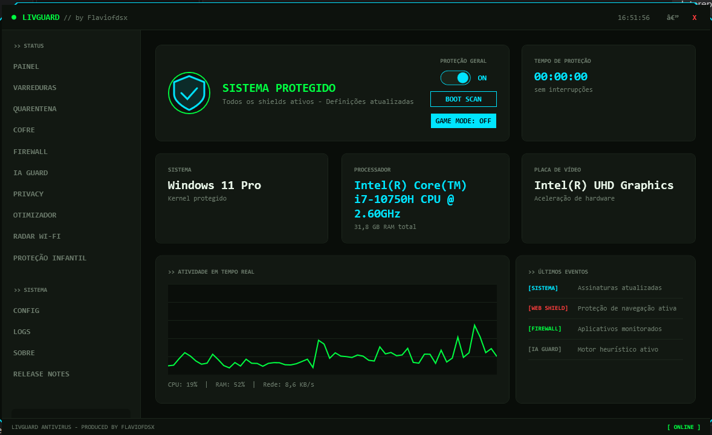
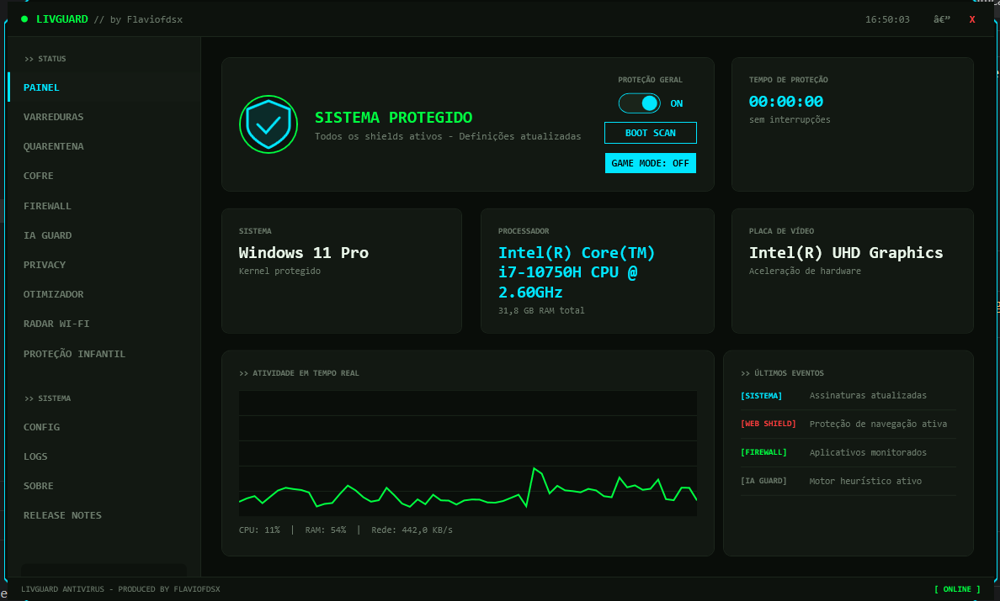
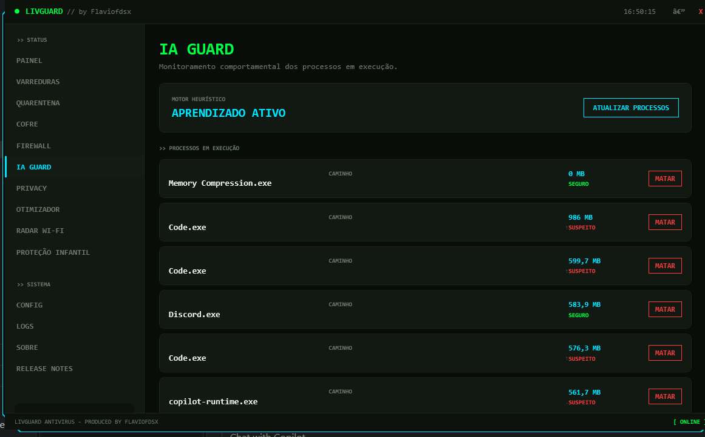
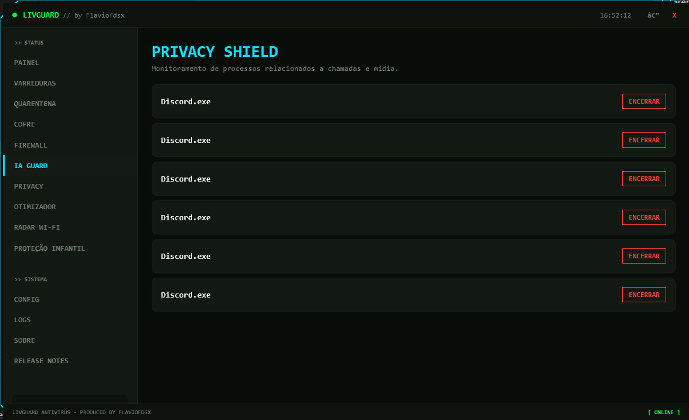
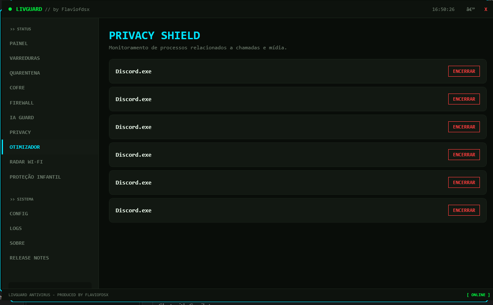
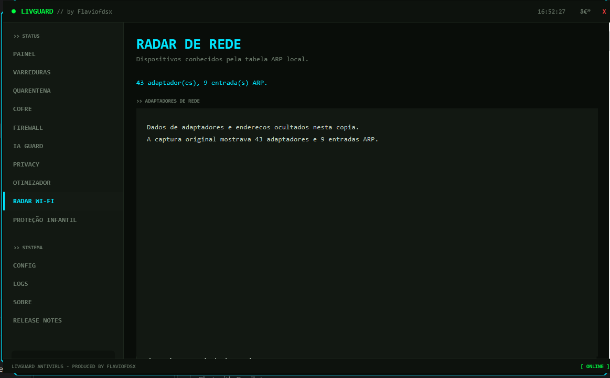

# 🛡️ LivGuard Antivirus

> *"É a proteção que criei para a minha filha e para o mundo."*  
> — **Flaviofdsx** (Criador)

O **LivGuard** é um antivírus open-source para Windows 10/11, construído em **C# (.NET 11)** e **WPF**, inspirado no visual e na performance da linha **Acer Predator**. O projeto foi desenvolvido para unir segurança de nível corporativo com uma interface gamer imersiva.


[Histórico de versões](CHANGELOG.md)

---

## ✨ Funcionalidades Principais

O LivGuard não é apenas um scanner; é uma suíte completa de segurança e monitoramento.

### 🛡️ Proteção em Tempo Real
- **File System Shield:** Monitoramento contínuo da pasta `Downloads` e diretórios críticos via `FileSystemWatcher`. Bloqueia e isola arquivos maliciosos automaticamente.
- **Web Shield & AdBlocker:** Bloqueio de domínios de phishing, rastreadores e anúncios indesejados.
- **System Integrity:** Monitora alterações suspeitas no Registro do Windows.
- **Auto-Updater:** Verificação silenciosa de novas assinaturas em background (a cada 24h).

### 🧠 Motores de Varredura
- **Varredura por Hash (SHA-256):** Comparação rápida com banco de dados SQLite.
- **Regras YARA:** Assinaturas EICAR e de notas de resgate, com varredura em blocos para arquivos menores que 500 MiB.
- **Memory Scanner:** Varredura de processos em execução na RAM (detecção de fileless malware).
- **AI File Analyzer:** Heurística simulada por Machine Learning para identificar "droppers".

### 🎮 Interface & Usabilidade (Predator Edition)
- **Design Imersivo:** Janela sem bordas nativas, cantos chanfrados e tema escuro profundo.
- **Execução administrativa:** Solicita elevação pelo UAC e habilita DPI por monitor. Como o aplicativo roda com privilégios elevados, aprove o prompt apenas se confiar na cópia executada.
- **Game Mode:** Muda para o tema *Vermelho Sangue*, tenta ativar o plano Alto Desempenho do Windows quando disponível e restaura o plano anterior ao desativar ou sair.
- **Gráfico Fluido:** Exibe uso real da CPU, memória RAM e tráfego de rede no painel principal.
- **Notificações Toast:** Avisos nativos do Windows 11 quando uma ameaça é bloqueada.

### 🛠️ Ferramentas Extras
- **Privacy Shield:** Monitor e bloqueador de processos que tentam acessar Webcam/Microfone.
- **Otimizador de PC:** Limpador de arquivos temporários e cache do Windows.
- **Radar de Rede (Wi-Fi):** Lista dispositivos conectados ao seu roteador e alerta sobre intrusos.
- **Proteção Infantil:** Bloqueio de sites adultos com senha (ideal para famílias).
- **Cofre (Vault):** Criptografia AES-256 para arquivos confidenciais.
- **Quarentena:** Isolamento seguro de arquivos infectados com opção de restauração.
- **Telegram Bot:** Envio de alertas de segurança direto no seu celular.

---

## 🖼️ Capturas de tela

### Painel inicial



O painel reúne o estado geral da proteção, informações do sistema, eventos recentes e um gráfico de atividade. Os valores de CPU, RAM e rede são leituras do computador no momento da captura.

### Telemetria



Exemplo do gráfico de atividade com percentuais de CPU e RAM e tráfego de rede em tempo real. Esses valores variam conforme o uso da máquina.

### IA Guard



A tela lista processos em execução com consumo de memória e uma classificação heurística. Essa classificação pode gerar falsos positivos e não confirma que um processo seja malware; não encerre processos apenas com base no rótulo. Os identificadores de processo e caminhos locais foram ocultados nesta captura.

### Privacy Shield e Otimizador





As capturas mostram uma lista de processos e ações para encerrá-los. O título da área aparece como “PRIVACY SHIELD”, mas cada imagem destaca um item diferente no menu lateral; a seleção visual não corresponde ao título exibido. Confira o processo antes de usar uma ação de encerramento.

### Radar de rede (Wi-Fi)



O radar apresenta adaptadores de rede e entradas da tabela ARP local — não é uma varredura da Internet nem uma confirmação de que cada dispositivo esteja conectado ao Wi-Fi. Endereços e detalhes dos adaptadores foram ocultados na captura.

---

## 🏗️ Arquitetura do Projeto

O projeto segue os princípios de **Clean Architecture** e está dividido em módulos:

```text
LivGuard/
├── Flavirus.Core/       # Motor de varredura, YARA, Quarentena, Cofre, WMI.
├── Flavirus.UI/         # Interface WPF, Tema Predator, Tray Icon, Notificações.
├── Flavirus.Service/    # Windows Service (opcional) para proteção em background.
├── Flavirus.Updater/    # Atualizador de assinaturas.
└── Flavirus.Tests/      # Testes unitários (xUnit) - Ex: Detecção de EICAR.
